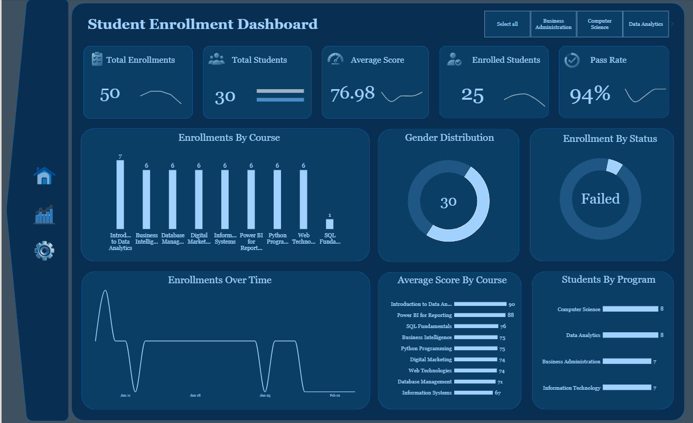
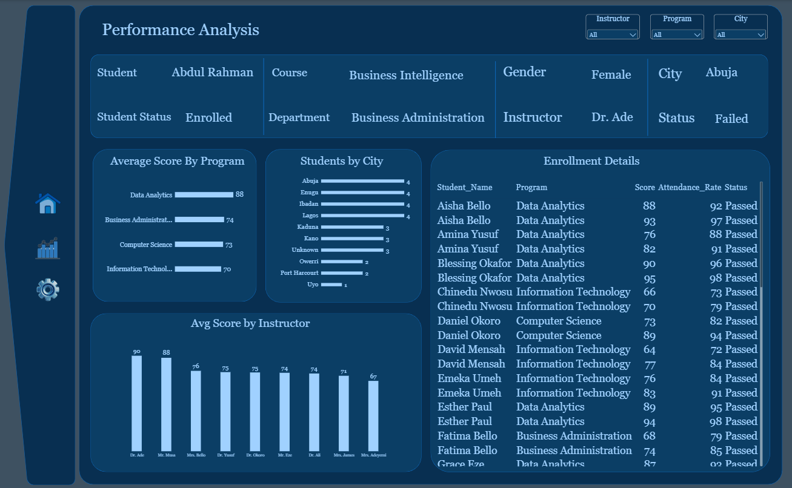

# Student Enrollment and Performance Insights

Using Power BI, I analysed student enrollment data to uncover insights on course uptake, academic performance, pass rates and student demographics. I cleaned three raw datasets in Power Query, built a star-schema data model with DAX measures, and designed a two-page interactive dashboard that answers key questions about courses, programs and students.

## Table of Contents

- [Dashboard Preview](#dashboard-preview)
- [Introduction](#introduction)
- [Data Overview and Dataset Structure](#data-overview-and-dataset-structure)
- [Data Cleaning and Preparation](#data-cleaning-and-preparation)
- [Data Model and DAX Measures](#data-model-and-dax-measures)
- [Dashboard Analysis](#dashboard-analysis)
- [Conclusion](#conclusion)
- [Recommendations](#recommendations)
- [Assumptions and Limitations](#assumptions-and-limitations)
- [Tools and Repository Structure](#tools-and-repository-structure)

## Dashboard Preview

**Page 1: Overview**



**Page 2: Performance Analysis**



## Introduction

Education providers need to know which courses attract students, how well students perform, and who is not engaging at all. Without this view, low-uptake courses go unnoticed, struggling students are found too late, and resources are spread without evidence.

This project analyses a student enrollment dataset using Microsoft Power BI to answer practical questions about enrollment and performance. The analysis aims to:

- Show how many enrollments each course has, to understand course uptake.
- Compare average scores across courses, programs and instructors.
- Count students by program and by city.
- Measure overall enrollments, students, average score and pass rate.
- Identify students who have never enrolled and enrollments that failed.
- Track how enrollments changed over the four-week period covered by the data.

## Data Overview and Dataset Structure

The analysis uses three related tables. Each enrolled student takes two courses within their own program, so a Student_ID appears twice in the Enrollment table. This is by design and is not duplication.

### Enrollment (fact table)

| Column | Description |
|---|---|
| Enrollment_ID | Unique identifier for each enrollment (primary key) |
| Student_ID | Links to the Students table |
| Course_ID | Links to the Courses table |
| Enrollment_Date | Date the student enrolled |
| Score | Score achieved in the course |
| Attendance_Rate | Percentage of sessions attended |
| Status | Passed or Failed |

### Students (dimension table)

| Column | Description |
|---|---|
| Student_ID | Unique identifier for each student (primary key) |
| Student_Name | Student's full name |
| Gender | Female, Male or Unknown |
| Age | Student's age |
| City | City of residence |
| Program | Data Analytics, Computer Science, Business Administration or Information Technology |

### Courses (dimension table)

| Column | Description |
|---|---|
| Course_ID | Unique identifier for each course (primary key) |
| Course_Name | Name of the course |
| Department | Department that runs the course |
| Instructor | Course instructor |
| Course_Level | Beginner or Intermediate |

After cleaning, the data holds **30 students**, **10 courses** and **50 enrollments**, with enrollment dates from 8 January to 3 February 2026. This is a practice dataset, not real student data.

## Data Cleaning and Preparation

All cleaning was done in Power Query, so every step is recorded and repeatable and the raw data is left untouched.

| Issue | Treatment |
|---|---|
| 2 fully duplicated rows (EN047, EN048) | Removed, reducing 52 rows to 50 enrollments |
| 6 missing Enrollment_IDs | Regenerated from the row sequence, validated against existing IDs, and flagged as Inferred |
| Missing Student_ID (2) and Course_ID (1) in Enrollment | Recovered from each student's course pairing and program |
| 5 missing Student_IDs in the Student table | Recovered and cross-checked against the courses each student took |
| Missing Program (1 student) | Set to Data Analytics from the student's course enrollments |
| Missing Status (2 rows) | Derived from score using a pass mark of 60 |
| Missing Score (1 row) | Left blank, so it is excluded from averages instead of being treated as zero |
| Missing Enrollment_Date (3 rows) | 1 inferred and flagged from a consistent 6-day gap between a student's two courses; 2 left blank |
| Missing Gender (1) and City (3) | Set to Unknown |

Inferred values are flagged in quality columns (`ID_Source`, `Date_Quality` and `Score_Quality`), so they can be identified or excluded at any time.

## Data Model and DAX Measures

The model is a star schema. **Enrollment** is the fact table, linked one-to-many from **Students** (Student_ID), **Courses** (Course_ID) and a **Dim_Date** calendar table (Date to Enrollment_Date_Clean).

```DAX
Total Enrollments = COUNTROWS(Enrollment)

Total Students = DISTINCTCOUNT(Students[Student_ID])

Enrolled Students = DISTINCTCOUNT(Enrollment[Student_ID])

Avg Score = AVERAGE(Enrollment[Score])

Pass Rate =
DIVIDE(
    CALCULATE(COUNTROWS(Enrollment), Enrollment[Status_Clean] = "Passed"),
    COUNTROWS(Enrollment)
)

Week Start (Dim_Date column) = [Date] - WEEKDAY([Date], 2) + 1
```

## Dashboard Analysis

This section explains each part of the dashboard, with the method and the insight it gives.

### 1. Headline KPIs

**Method:** Five cards show Total Enrollments, Total Students, Average Score, Enrolled Students and Pass Rate, using the measures above.

The dashboard records **50 enrollments** from **30 registered students**, of whom **25 are enrolled** in at least one course. The average score is **76.98**, calculated from 49 scores because one is missing, and the pass rate is **94%** (47 of 50 enrollments). The gap between 30 and 25 means five students (17%) have never enrolled in a course, which is a clear follow-up for student support.

### 2. Enrollments by Course

**Method:** A column chart counts enrollments for each course.

Introduction to Data Analytics is the most popular course with 7 enrollments. Seven other courses have 6 each. SQL Fundamentals has just 1 enrollment, and Data Visualization has none, so it does not appear on the chart. This points to two courses that are either not being promoted, not required or not scheduled.

### 3. Average Score by Course

**Method:** A bar chart shows the average score for each course.

Introduction to Data Analytics (90) and Power BI for Reporting (88) score highest. Information Systems (67) and Database Management (71) score lowest. The gap between the top and bottom courses is about 23 points, so performance varies a lot depending on the course.

### 4. Students by Program

**Method:** A bar chart counts students in each program using the Students table.

Students are spread evenly: Data Analytics and Computer Science have 8 each, and Business Administration and Information Technology have 7 each, giving 30 in total.

### 5. Gender Distribution and Enrollment by Status

**Method:** Two donut charts show the split of students by gender and of enrollments by status.

There are 15 female students, 14 male students and 1 whose gender is unknown. Of the 50 enrollments, 47 (94%) passed and 3 (6%) failed. The three failures are in Information Systems (score 40), Python Programming (58) and Web Technologies (55), and all three belong to male students. Gender and program overlap almost completely in this dataset, so these results describe a pattern and do not show that gender affects performance.

### 6. Enrollments Over Time

**Method:** A line chart plots enrollments by week using a Dim_Date calendar table.

Weekly enrollments were 9 (week of 5 January), 13 (12 January), 14 (19 January), 10 (26 January) and 2 (2 February). The last week is partial because the data ends on 3 February. Two enrollments have no recorded date and are not shown.

### 7. Average Score by Program

**Method:** A bar chart shows the average score for each program.

Data Analytics students average **88.4**, followed by Business Administration (74.5), Computer Science (72.9) and Information Technology (70.0). Data Analytics sits about 18 points above Information Technology.

### 8. Students by City

**Method:** A bar chart counts students by city.

Lagos, Abuja, Ibadan and Enugu have 4 students each. Kano, Kaduna and Unknown have 3 each, Owerri and Port Harcourt have 2 each, and Uyo has 1. Three students have no city recorded.

### 9. Average Score by Instructor

**Method:** A column chart shows the average score for each instructor.

Scores run from 90.3 (Dr. Ade) and 88.3 (Mr. Musa) down to 66.5 (Mrs. Adeyemi). Each instructor teaches only one course in this dataset, so this chart repeats the course chart and cannot show whether the instructor, the course difficulty or the student group explains the differences. It should not be used to judge individual instructors.

### 10. Enrollment Details and Selected Student Record

**Method:** A table lists every enrollment with student, program, score, attendance and status. Clicking a row fills a Selected Student Record panel, and dropdown slicers filter by Instructor, Program and City.

This gives a drill-down from the overall picture to a single student, which is useful for finding the five students who have not enrolled and the three failed enrollments.

## Conclusion

The dashboard shows a healthy overall picture with room to improve in specific places:

- **Course uptake:** Introduction to Data Analytics leads with 7 enrollments, while SQL Fundamentals has 1 and Data Visualization has none.
- **Performance:** the average score is 76.98 and the pass rate is 94%.
- **Programs:** Data Analytics averages 88.4, about 18 points above Information Technology at 70.0.
- **Failures:** all three failed enrollments are in Information Systems, Python Programming and Web Technologies.
- **Engagement gap:** 5 of 30 registered students have not enrolled in any course.
- **Timing:** enrollments peaked in the weeks of 12 and 19 January.

## Recommendations

1. **Review the low-uptake courses.** SQL Fundamentals and Data Visualization need attention. Check whether they are scheduled, promoted or required, and decide whether to keep, merge or relaunch them.
2. **Follow up the five students who have not enrolled.** Reach out with guidance or enrollment support.
3. **Support the courses with failures.** Python Programming, Web Technologies and Information Systems each had one failed student, and Information Systems has the lowest average score.
4. **Investigate the program gap.** Information Technology averages about 18 points below Data Analytics. Gather more data, such as course difficulty and prior preparation, before drawing conclusions.
5. **Improve data capture.** Missing IDs, dates, genders, cities and programs had to be inferred or left blank. Making these fields mandatory would remove that risk.

## Assumptions and Limitations

- A **pass mark of 60** was assumed. Original status labels were kept wherever they existed.
- Missing IDs, one enrollment date and one program were **inferred** from patterns in the data. They are flagged in the data but are not recorded facts.
- One enrollment has **no score** and is excluded from averages. Two have **no date** and are excluded from the time trend. All are kept in other counts.
- With 30 students and 50 enrollments, the findings describe patterns and do not support statistical conclusions.
- Program, gender, course and instructor overlap heavily, so differences between them cannot be attributed to a single factor.
- The data covers about four weeks, and the last week is partial.

## How to View the Dashboard

- **Quick look:** see the screenshots above.
- **PDF:** [Download the dashboard as PDF](Student_Enrollment_Dashboard_Report.pdf)
- **Live version:** [Open the interactive dashboard](https://www.loom.com/share/7fc209caf58e4dcc936a095a8cb9e81a)
- **Full file:** download the `.pbix` from `powerbi/` and open it in [Power BI Desktop](https://powerbi.microsoft.com/desktop/) (free, Windows only).

## How to Explore This Project

- **Quick look:** see the query screenshots in [SQL Queries and Analysis](#sql-queries-and-analysis).
- **PDF:** [Download the analysis as PDF](your-pdf-link)
- **Walkthrough:** [Watch the query demo on Loom](https://www.loom.com/share/9b0700cc94b94a6e9b22ecfd940800c3)
- **Full script:** [View all 25 queries](TWDP_SQL_Assignment.sql).
- **Data:** [`Patients.csv` and `Doctors.csv`](data/) are the source tables.
- **Run it yourself:** import the two CSV files into a SQL Server database named `TWDP Assignment`, then open the `.sql` script in [SQL Server Management Studio](https://learn.microsoft.com/sql/ssms/download-sql-server-management-studio-ssms) (free, Windows only) and run the queries.

## Tools and Repository Structure

**Tools:** Power BI Desktop, Power Query (M), DAX, Excel.

```
.
├── README.md
├── powerbi/    # .pbix dashboard file
├── data/       # raw source tables
├── report/     # full written report (Word)
├── images/     # dashboard screenshots
├── icons/      # custom KPI icons (SVG)
└── theme/      # Power BI theme JSON
```

## Author

**Aisha Hamza** | [LinkedIn](https://www.linkedin.com/in/aisha-hamza-a21188187/) | [Email](hamzaaisha798@gmail.com)
